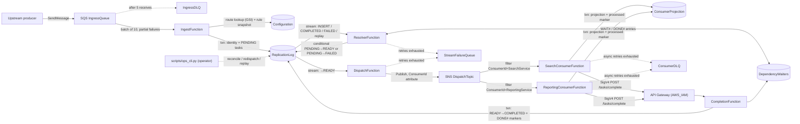

# Dependency-Aware Event Processing Platform

A serverless, asynchronous event-processing platform on AWS that enforces **configurable cross-event dependencies and time-window constraints** without a global FIFO queue. It is written in Python and runs on AWS Lambda, SQS, SNS, DynamoDB, and DynamoDB Streams, all defined in an AWS SAM template.

## Overview

Many event pipelines get their correctness from queue ordering. Real workflows often need something else: an event should be processed only after a *specific earlier event* has been fully processed by a *specific downstream service*, and sometimes only if that happened *recently*. Those dependencies cross producers, services, and time. A single ordered queue cannot express them without also making every unrelated event wait.

This platform sits between upstream **producers** and downstream **consumers**:

1. Producers send immutable source events (`EventId`, `ProducerId`, `Action`, `Timestamp`, `Parameters`) to an SQS queue. Each event describes a change that has already been committed upstream.
2. Each event fans out into one **consumer task** per subscribed consumer, identified by `(ProducerId, EventId, ConsumerId)`. Each task is tracked separately in DynamoDB.
3. A task waits in `PENDING` until every dependency rule configured for it is satisfied. It then becomes `READY` and is delivered to its consumer through SNS.
4. The consumer does its real downstream work and acknowledges through an IAM-authenticated Completion API. Only that acknowledgement moves the task to `COMPLETED`, which in turn wakes any tasks that were waiting on it.

Tasks with no unmet dependencies go through the pipeline concurrently. Ordering applies only where a rule asks for it.

## Motivation

*Illustrative example (not a commercial deployment):* a `ContentService` emits `CreatePaper(PaperId=123)` and a `CommentService` emits `MakeComment(PaperId=123)`. A search-indexing consumer must not index the comment before it has indexed the paper. Over an asynchronous network, the comment event can arrive first.

- **Event A** (`CreatePaper`, paper 123) must be `COMPLETED` by `SearchService` before **Event B** (`MakeComment`, paper 123) is dispatched to `SearchService`.
- **Event C** (`CreatePaper`, paper 999) has no relationship to A or B and goes through right away, even while B is blocked.

Why not just use a FIFO queue?

- **A global FIFO serializes unrelated work.** Event C waits behind B even though nothing links them.
- **Arrival order is not the order that matters.** The constraint is "A was *completed* by service X", not "A arrived first". A FIFO queue preserves send order only. It knows nothing about downstream completion.
- **Dependencies are per consumer.** B may depend on A for `SearchService` and not depend on it at all for `ReportingService`. Message groups cannot express that.
- **Time windows matter.** A rule can require the prerequisite to have completed within the last *N* seconds, measured from when it completed, not from when the event was created.

## Key Features

Each item below is implemented in `src/event_platform/` and covered by tests in `tests/`.

- **Configurable dependency rules.** Rules are stored in DynamoDB using the fields `ClientId`, `ClientAction`, `ProducerId`, `Action`, `ServiceConsumer`, `Parameter`, `Operation`, and `lastEventGap`. A rule is satisfied when there **exists** a `COMPLETED` predecessor task with the same producer, action, and *named* consumer, and an equal parameter value (for example `PaperId`). Multiple rules on one task combine with **AND**. Only the `EQUAL` operator is supported, and any other operator is rejected (fail closed).
- **Time-window constraints.** `lastEventGap` (seconds, `-1` = unlimited) is measured against the predecessor's completion time (`StatusUpdatedOn`), not the event timestamp. If the only matching predecessor is too old, the task stays `PENDING` until a newer one completes.
- **Per-consumer fan-out.** One source event becomes N independent tasks. An identity record and all its tasks are written in a single DynamoDB transaction, up to 99 consumers per event, and larger fan-outs are rejected.
- **Push-based dependency resolution.** The resolver reacts to DynamoDB Streams records instead of polling. A reverse index (`DependencyWaiters`) maps each dependency to the tasks waiting on it and to the predecessor completions that satisfy it.
- **Race-free wakeups.** A waiter is registered *before* a strongly consistent recheck. The `COMPLETED` transition and its completion markers are committed in the same transaction. Together these prevent lost wakeups, and tests cover every interleaving.
- **Idempotent processing.** Retried ingestion with the same `EventId` and payload is a no-op. The same `EventId` with a different payload is rejected. All status transitions are conditional writes. The demo consumers commit their side effect together with a per-task "processed" marker, so duplicate SNS deliveries are absorbed.
- **Authenticated acknowledgement.** The Completion API (API Gateway REST, `AWS_IAM` auth) accepts an ACK only from the IAM role registered for that `ConsumerId`, only for a task that matches, and only while the task is `READY`.
- **Retries and dead-letter handling.** Ingestion uses SQS retries with partial batch failure reporting, sending messages to a DLQ after 5 receives. Stream processors get finite retries, batch bisection, and an on-failure queue. Consumers get Lambda async retries and an on-failure DLQ.
- **Failure propagation.** A terminal consumer failure marks the task `FAILED` and propagates `DEPENDENCY_FAILED` to blocked dependents. The root cause and failure chain are recorded, and work that is already `READY` or `COMPLETED` is left alone. If another valid predecessor has completed, the dependent is not failed.
- **Operator recovery.** `scripts/ops_cli.py` provides authorized replay (`FAILED → PENDING`, keeping the original `EventId` and `Timestamp`, with replay generation and history recorded), re-dispatch of stale `READY` tasks, reconciliation of `PENDING` tasks after missed stream wakeups, and read-only DLQ inspection. Every command is a dry run unless `--commit` is passed.
- **Observability.** Structured JSON logs and CloudWatch Embedded Metric Format counters, plus CloudWatch alarms on the depth of the three failure queues.
- **Automated verification.** A local test suite on moto, live AWS end-to-end and failure-injection scenarios, and a bounded load generator with backpressure and checkpoints.

## Technology Stack

| Area | Technology | Used for |
|---|---|---|
| Language | Python 3.12, boto3 | All Lambda code and tooling |
| Compute | AWS Lambda (arm64) | Ingest, Resolver, Dispatch, Completion, two demo consumers |
| Ingestion | Amazon SQS (standard) + DLQ | Durable intake of source events |
| State | Amazon DynamoDB (on-demand) | Configuration, ReplicationLog, DependencyWaiters, ConsumerProjection tables |
| Change feed | DynamoDB Streams | Trigger the Resolver and Dispatch on task status changes |
| Delivery | Amazon SNS | Fan out `READY` tasks to consumers with per-`ConsumerId` filter policies |
| ACK endpoint | Amazon API Gateway (REST, IAM auth) | Consumer completion acknowledgements |
| Failure capture | SQS queues as DLQs and on-failure destinations | Ingress DLQ, StreamFailureQueue, ConsumerDLQ |
| Observability | Amazon CloudWatch Logs, Metrics (EMF), Alarms | Logs, custom counters, DLQ-depth alarms |
| IaC | AWS SAM / CloudFormation | `template.yaml` |
| Testing | pytest, moto | Local tests with no AWS calls |

## Architecture



Solid arrows show the normal path. Dashed arrows show failure capture and operator recovery.

| Component | Responsibility |
|---|---|
| **IngressQueue (SQS)** | Holds source-event *messages*. A dependency wait never holds a message or a Lambda invocation. Once an event is ingested, any wait is persisted in DynamoDB and the message is acknowledged. |
| **IngestFunction** (`handlers.lambda_handler` → `ingestion.ingest`) | Strict schema validation (canonical UUIDv4 `EventId`, epoch-ms `Timestamp`, object `Parameters`, no duplicate JSON keys). Looks up subscribed consumers through a GSI and snapshots each consumer's rules onto its task. Writes the identity record and N `PENDING` tasks atomically. Reports per-message batch failures. |
| **ReplicationLog (DynamoDB)** | PK `ProducerId`. SK is `EVENT#<EventId>` for identity records and `<Action>#<ConsumerId>#<Timestamp13>#<EventId>` for tasks. Holds status, timestamps, dispatch attempts, and failure/replay metadata. Its stream (`NEW_AND_OLD_IMAGES`) drives the Resolver and Dispatch. |
| **ResolverFunction** (`resolver.Resolver`) | Evaluates new `PENDING` tasks, wakes waiters when a predecessor completes, propagates terminal failures, and re-evaluates replayed tasks. Stream filter criteria limit it to those transitions. |
| **DependencyWaiters (DynamoDB)** | Key `DependencyKey = (ProducerId, Action, ServiceConsumer, Parameter, value)`. `WAIT#<TaskId>#<RuleId>` entries record outstanding waiters. `DONE#<StatusUpdatedOn>#<EventId>` entries record predecessor completions and support time-window range queries. |
| **DispatchFunction** (`dispatch.Dispatcher`) | Publishes one SNS message per task that has just become `READY`, then records `DispatchedAt` and `DispatchAttempts`. Dispatch does **not** complete a task. |
| **SNS DispatchTopic** | One topic. Each consumer subscription filters on the `ConsumerId` message attribute. |
| **Demo consumers** (`consumer.DemoConsumer`) | Stand-ins for downstream services. Each applies a real DynamoDB projection write and a processed-marker in one transaction, then sends a SigV4-signed ACK, retrying in-process on 429/5xx responses. |
| **Completion API + CompletionFunction** (`completion.CompletionService`) | Checks the caller's IAM role, task ownership, and current state. Commits `READY → COMPLETED` together with the `DONE#` markers, or records `READY → FAILED` with a reason. |
| **Failure queues** | IngressDLQ (poison messages), StreamFailureQueue (stream batches that ran out of retries), ConsumerDLQ (consumer invocations that ran out of retries). |

## Event Processing Workflow

Here is how a `MakeComment` event for paper 123 moves through the system when it arrives **before** the `CreatePaper` it depends on.

1. **Receive.** The producer sends the event to SQS. `IngestFunction` validates it, finds the subscribed consumers (`SearchService`, `ReportingService`), and reads each consumer's rules for `MakeComment` with a strongly consistent read.
2. **Store.** A single `TransactWriteItems` call writes the identity item and two `PENDING` tasks. Each task stores a snapshot of its rules, so later configuration edits do not change rules for events already in flight. If the same event is delivered again, the transaction's conditions fail, the stored payload fingerprint matches, and the result is `duplicate`. Nothing new is created.
3. **Evaluate.** The task `INSERT` appears on the stream and invokes the Resolver. For each rule, the Resolver first writes a `WAIT#` entry under the rule's dependency key, then runs a strongly consistent query for a matching `DONE#` entry (bounded by `lastEventGap` if one is set). No paper has completed yet, so the task stays `PENDING`. The SQS message has already been acknowledged, and SQS does not retry business-level waiting.
4. **Become eligible.** The `CreatePaper` event arrives. Its tasks have no rules, so the Resolver moves them straight to `READY`. Dispatch publishes them to SNS, and `SearchConsumerFunction` indexes the paper and ACKs.
5. **Complete and wake dependents.** `CompletionFunction` commits `READY → COMPLETED` together with a `DONE#` marker for every indexable parameter of the completed task. That `MODIFY` stream record invokes the Resolver, which queries `WAIT#` entries under the matching dependency key and re-checks **all** rules of each waiting task. When every rule holds, a conditional update moves the task `PENDING → READY` and its waiter entries are deleted. Repeated stream deliveries or concurrent wakeups lose the condition check and change nothing.
6. **Dependency failure.** If a consumer reports a terminal failure, the task becomes `FAILED` with `RootFailureEventId` and `FailureChain` recorded. The Resolver then fails each blocked `PENDING` dependent with `DEPENDENCY_FAILED`, unless another valid completed predecessor still satisfies that dependent's rule. Tasks already `READY` or `COMPLETED` are never rolled back.
7. **Retry and recovery.**
   - Transient ingestion errors are retried by SQS (60 s visibility timeout, 5 receives) and then go to IngressDLQ. A message in the DLQ does **not** create a `FAILED` task. An operator inspects it and replays it.
   - Transient consumer errors are retried by Lambda async invoke (2 retries), then go to ConsumerDLQ. The task stays `READY` (dispatched but not completed) until it is re-dispatched.
   - Stream-processing errors get 5 retries with batch bisection and then go to StreamFailureQueue. Because stream retention is limited (about 24 h), `ops_cli.py reconcile` re-evaluates every `PENDING` task.
   - `ops_cli.py replay --root <EventId>` resets a failure chain `FAILED → PENDING`. The Resolver then re-checks every rule from scratch.

## Key Engineering Decisions

### 1. Dependency-aware ordering instead of global FIFO

- **What is guaranteed:** a task becomes `READY` only after, for each of its rules, some predecessor task has reached `COMPLETED` by the *named* consumer with a matching parameter value, within the time window if one is set. "Completed" means the consumer's authenticated ACK was received.
- **What is not guaranteed:** total order, or ordering between events no rule relates. Two events for the same paper with no rule between them can be processed in either order. The platform does not detect causal history. It enforces only the dependencies that are configured.
- **What runs concurrently:** every task whose rules are satisfied, including other consumers' tasks for the same event. In the live concurrency scenario, 20 independent tasks completed while an unrelated task stayed blocked.
- **Limitations:** dependency cycles and configuration changes made while traffic is flowing can leave tasks permanently `PENDING`. Cycle validation is not implemented. Rules should be seeded before traffic.

### 2. Event-driven architecture

- SQS decouples producers from processing and supplies retries and a DLQ for free. Lambda scales with demand and does not run while the system is idle.
- **DynamoDB Streams are the core trigger.** Every state change (task created, completed, failed, replayed) is a durable record the Resolver reacts to. Dependency checks are driven by completions instead of polling. DynamoDB keeps a durable record of task state, while Lambda invocations do not.
- Dispatch and resolution are separate Lambdas on the same stream with separate filter criteria. Delivery problems therefore do not hold up dependency evaluation, and the reverse is also true.

### 3. Idempotency and retry semantics

SQS, SNS, Lambda async invoke, and DynamoDB Streams all deliver **at least once**, so every stage is designed to tolerate duplicates:

| Stage | Duplicate defence |
|---|---|
| Ingestion | Conditional transactional puts plus a payload fingerprint. A duplicate is a no-op, and a conflicting payload is rejected. |
| Resolver | Waiter puts are idempotent, and status transitions are conditional (`Status = :from AND TaskId = :tid`). |
| Dispatch | A duplicate publish is possible, for example after a crash between publish and bookkeeping. Consumers absorb it. |
| Consumer | The projection write and a `MARKER#<consumer>/TASK#<TaskId>` record are committed in one transaction. A replay re-sends only the idempotent ACK. |
| Completion | A repeated identical ACK returns `200 duplicate`. |

This gives **at-least-once delivery with idempotent state transitions and side effects**. It does **not** provide exactly-once execution across services, and no such claim is made.

### 4. Failure propagation and recovery

- **Recoverable:** transient ingest errors (SQS retry), transient consumer errors (Lambda async retry), stream-processor errors (stream retry, then on-failure queue plus reconciliation), and an ACK that never arrives (re-dispatch of stale `READY` tasks).
- **Terminal:** a consumer's explicit failed ACK, or a dependency failure propagated from it. These are recorded as `FAILED` with the reason, root event, and chain. Poison or malformed ingress messages go to IngressDLQ.
- **Recovery is explicit and audited.** Replay keeps the original event identity and timestamp, increments `ReplayGeneration`, and appends to `FailureHistory`. A recovered task counts as done only after its real side effect runs and the ACK succeeds.

### 5. Scalability and bottlenecks

- Independent work proceeds in parallel at every stage, and blocked tasks use no compute while they wait.
- **The observed bottleneck is the Resolver's stream mapping.** In the 10,000-event live run, Resolver concurrency peaked at **4**, which equals the number of open stream shards with `ParallelizationFactor = 1`. Every batch was full (about 25 records), and each batch took about 1.34 s, because each record makes several *sequential* DynamoDB round trips (task read, waiter put, strongly consistent `DONE#` query per rule, conditional update, waiter cleanup). That comes to roughly 19 records/s per shard. Resolver `IteratorAge` rose to 169 s while load was offered and fell once sending stopped. Other functions stayed far below their limits: summed peak concurrency was 36 against an account limit of 1,000, with zero throttles and zero DynamoDB write throttles.
- Every task, including one with no dependencies, goes through the Resolver once on `INSERT`. The Resolver therefore caps end-to-end throughput even for independent work.
- Possible next steps (**not implemented or measured**): raise `ParallelizationFactor`, run the per-rule `DONE#` lookups in parallel, and batch waiter cleanup. The `ProducerId` partition key also means a single very hot producer could eventually reach DynamoDB per-partition limits.

## Testing and Validation

### Local tests (run during publication, no AWS calls)

68 pytest tests run against [moto](https://github.com/getmoto/moto). `tests/local_pipeline.py` drives the real handlers and simulates the stream and SNS hops in-process.

| Category | Files | Covers |
|---|---|---|
| Unit / contract | `test_ingestion.py`, `test_components.py` | Schema validation, stable UUID semantics, conflicting payloads, fan-out limits, partial batch responses, key encoding, type-strict `EQUAL`, rule validation, SigV4 signing, stream batch failure reporting. Also template checks: stream filter coverage, IAM actions inside transactions, and Completion API invoke mode. |
| Mocked integration (moto + simulated streams) | `test_matrix.py`, `test_e2e_p0.py` | Out-of-order delivery, cross-consumer rules, AND rules in both arrival orders, wrong parameter/producer/action, time windows, independence from blocked work, duplicate SQS/SNS/stream deliveries, crash between publish and bookkeeping, forged/wrong-consumer ACKs, transient and persistent ingest failures, DLQ, terminal failure propagation and replay, alternative-predecessor handling, **every completion-vs-waiter-registration interleaving**, simultaneous parent completions, reconciliation, ACK retry behaviour. |
| Load-test harness | `test_load_test.py` | Wave checkpoints, rate cap, backpressure, and stall detection of `scripts/load_test.py`. |

### Live AWS results (historical, October 2026; not re-run for this publication)

These runs were made against a dedicated development stack in one AWS region with the scripts in `scripts/`. Raw evidence is not included in this repository.

**End-to-end and failure-injection scenarios** (`scripts/verify_e2e.py`). All of the following passed: out-of-order (E2 before E1) with projection order verified, cross-consumer dependency, multi-rule AND, wrong parameter, 30 s time window, concurrency with a blocked task, duplicate ingestion (5 sends gave 2 tasks and one side effect each), forged and unsigned ACKs rejected (403), terminal failure propagation followed by replay to `COMPLETED`, transient ingest failure succeeding on the 3rd receive, poison message reaching IngressDLQ after 5 receives, and ConsumerDLQ capture followed by operator re-dispatch with no duplicate side effects.

The first live run **failed**: ACKs returned HTTP 500 because SAM's default `AWS_IAM` invoke role uses caller credentials. The fix (`InvokeRole: NONE`) is in `template.yaml`, along with a regression test.

**Load tests** (`scripts/load_test.py`). Half the events were independent `CreatePaper` and half were dependent `MakeComment` events for the same papers, shuffled so many comments arrive first. Each event fans out to 2 consumers.

| Run | Source events / tasks | Completed | Ordering / cross-consumer violations | Duplicate or missing side effects | Wall clock | Throughput (tasks/s) |
|---|---|---|---|---|---|---|
| 100 events | 100 / 200 | 200 / 200 | 0 / 0 | 0 / 0 | 12.1 s | 16.6 avg |
| 10,000 events, rate-capped at 25 events/s with backpressure | 10,000 / 20,000 | **20,000 / 20,000** | **0 / 0** | **0 / 0** | 1,055 s | **19.0 avg, 28.6 peak 60 s window** |

The 10,000-event run in more detail:

- No dependent task became `READY` before its prerequisite completed (0 of 10,000). 5,612 dependent tasks were ingested before their prerequisite had completed.
- Lambda errors were 0, throttles were 0, and DynamoDB write throttles were 0. No queue (IngressDLQ, ConsumerDLQ, StreamFailureQueue) grew.
- There was one consumer invocation and one ACK per task.
- `READY → ACK` p50 / p95 / p99 was **0.36 / 1.03 / 1.69 s**. Independent tasks took a median of 77 s from ingest to ACK, almost all of it queued in the stream before the Resolver ran (see the bottleneck section above).
- One task has no dispatch bookkeeping: its ACK committed before the conditional `mark_dispatched` update ran, so that update was skipped. The task was dispatched once and its side effect was applied once.

These numbers come from controlled experiments on a single development stack. 20,000 completed tasks over about 17.5 minutes is **not** 20,000 tasks/s, and the measured throughput is far below what the managed services can handle, because of the Resolver bottleneck described above. Not verified live: a crash between publish and bookkeeping, duplicate stream delivery, the alternative-predecessor rule, race interleavings (covered locally only), `reconcile`, and throughput above about 30 tasks/s.

## Getting Started

### Prerequisites

- Python **3.12** (matches the Lambda runtime)
- [AWS CLI v2](https://docs.aws.amazon.com/cli/latest/userguide/getting-started-install.html) and [AWS SAM CLI](https://docs.aws.amazon.com/serverless-application-model/latest/developerguide/install-sam-cli.html), needed only for deployment
- An AWS account you control. Use a **non-production** account, and credentials scoped to CloudFormation, Lambda, IAM role creation, DynamoDB, SQS, SNS, API Gateway, and CloudWatch

### Run locally (no AWS account needed)

```bash
python3.12 -m venv .venv
source .venv/bin/activate
pip install -r requirements-dev.txt

pytest -q                          # 68 tests, moto-backed, no AWS calls
python examples/local_e2e_demo.py  # E2-before-E1 timeline on the local simulated pipeline
```

### Deploy (optional; creates billable AWS resources)

> ⚠️ Deploying creates Lambda functions, DynamoDB tables, SQS queues, an SNS topic, an API Gateway REST API, alarms and log groups. Everything is pay-per-request, but running the live tests and especially the load test **will incur charges**. `EnableFaultInjection` defaults to `true` so the failure-injection scenarios work. Set it to `false` if you do not need them.

```bash
sam validate --lint
sam build
sam deploy --guided \
  --stack-name <your-stack-name> \
  --region <your-region> \
  --capabilities CAPABILITY_IAM \
  --parameter-overrides Environment=dev EnableFaultInjection=true
```

The live scripts read stack outputs (queue URLs, table names, topic ARN) from CloudFormation and require explicit `--profile`, `--region`, and `--stack` arguments. None of them have a default account or stack.

```bash
COMMON="--profile <your-aws-profile> --region <your-region> --stack <your-stack-name>"

# 1. Seed subscriptions + dependency rules (dry run without --commit), and wait for GSI visibility
python scripts/seed_config.py $COMMON --commit

# 2. Run live end-to-end scenarios (add --slow for SQS retry / DLQ scenarios, which take minutes)
python scripts/verify_e2e.py $COMMON --only p0 forged_ack

# 3. Optional bounded load test (N > 1000 requires --allow-large)
python scripts/load_test.py $COMMON --events 100
```

### Send a sample event and inspect the result

```bash
aws sqs send-message --profile <your-aws-profile> --region <your-region> \
  --queue-url <IngressQueueUrl from stack outputs> \
  --message-body file://examples/event_create_paper.json

aws dynamodb query --profile <your-aws-profile> --region <your-region> \
  --table-name <ReplicationLogTableName from stack outputs> \
  --key-condition-expression "ProducerId = :p" \
  --expression-attribute-values '{":p":{"S":"ContentService"}}'
```

The live scripts generate a fresh UUIDv4 `EventId` for each event. Re-sending the same sample file with the same `EventId` is treated as a duplicate.

Operator commands (dry run unless `--commit`):

```bash
python scripts/ops_cli.py $COMMON dlq-inspect --queue IngressDLQUrl   # read-only; never deletes
python scripts/ops_cli.py $COMMON reconcile                           # re-evaluate PENDING tasks
python scripts/ops_cli.py $COMMON redispatch --older-than 300         # re-publish stale READY tasks
python scripts/ops_cli.py $COMMON replay --root <EventId>             # FAILED -> PENDING for a failure chain
```

Analysis helpers: `scripts/watch_stream.py` (read-only CloudWatch watch), `scripts/analyze_run.py`, `scripts/audit_window.py`, `scripts/compare_runs.py`. Scripts write their output to `tests/results/`, which is git-ignored.

### Clean up

```bash
sam delete --stack-name <your-stack-name> --region <your-region>
```

This deletes every stack resource, including the DynamoDB tables and their data.

## Observability

What is actually implemented:

- **Structured JSON logs** from every component with stable fields (`EventId`, `TaskId`, `ProducerId`, `ConsumerId`, `Action`, `prevStatus`, `newStatus`, `reason`, latency). Log groups use 14-day retention.
- **Custom metrics through CloudWatch Embedded Metric Format** (namespace `EventPlatform/<Environment>`, dimension `Component`). Examples: `EventsIngested`, `DuplicateEvents`, `IngestFailures`, `TasksReady`, `TasksDispatched`, `TasksCompleted`, `EndToEndLatencyMs`, `TasksFailedByConsumer`, `TasksFailedByPropagation`, `DuplicateAcks`, `AckRejected`, `AckRetries`, `SideEffectsApplied`, `DuplicateDeliveries`, `TasksReplayed`, `TasksRedispatched`. No `PutMetricData` permission is required.
- **CloudWatch alarms** (defined in `template.yaml`, no notification actions) fire when IngressDLQ, ConsumerDLQ, or StreamFailureQueue contains any message.
- **Native metrics used in testing**, collected by the load-test and watch scripts: Lambda Invocations, Errors, Throttles, Duration, and ConcurrentExecutions; stream `IteratorAge` (the key signal for the Resolver bottleneck); SQS depth and age of oldest message; DynamoDB write throttles.

There are no CloudWatch dashboards. CloudWatch error counts are not treated as proof of correctness. Ordering is verified from DynamoDB status timestamps and consumer projection order.

## Known Limitations

- **Throughput** is limited by the Resolver stream mapping: about 19 tasks/s on average and 28.6 tasks/s at peak in the measured configuration. Scaling options have been identified but not implemented or measured.
- **At-least-once semantics.** Duplicates are absorbed through idempotency, not prevented, and exactly-once execution is not claimed.
- **Rule language.** Only `EQUAL` on one parameter per rule. There is no cycle detection, and rule changes while traffic is flowing are unsupported (rules are snapshotted when an event is ingested).
- **Time windows** depend on Lambda wall-clock time compared with stored completion timestamps. There is no protection against clock skew beyond what AWS provides.
- **Recovery is operator-driven.** Ingress DLQ messages, missed ACKs (stale `READY`), and stream failures need `ops_cli.py`. There is no automatic ACK-timeout sweeper, and `DONE#` markers have no TTL or cleanup.
- **Reconciliation commands use table scans.** That is acceptable for operator use and is not designed for large tables.
- **Hot-partition risk** comes from the `ProducerId` partition key under a single very active producer. This has not been observed in testing.
- **Fan-out limit**: at most 99 consumers per event, because of the DynamoDB transaction item limit.
- **Demo consumers** stand in for real downstream services.
- **Not production-deployed.** The platform has no production users, and AWS testing was limited to controlled experiments on a development stack. Running it costs money.

## Project Scope

This is a personally driven engineering project that explores AWS serverless architecture, asynchronous event processing, and dependency-aware (causal) ordering. It demonstrates design choices such as conditional state machines, race-free wakeups, idempotency at every hop, and explicit recovery. Each claim is checked against automated local tests and controlled live AWS experiments. It is not a production system.

The problem framing (dependency-based ordering of replicated action messages, using a Configuration / ReplicationLog data model) comes from an earlier academic course project (ECE1724). This repository is a separate reimplementation that extends that design with push-based resolution, per-consumer tasks, authenticated ACKs, failure propagation, and replay. It contains no code from that course project.
